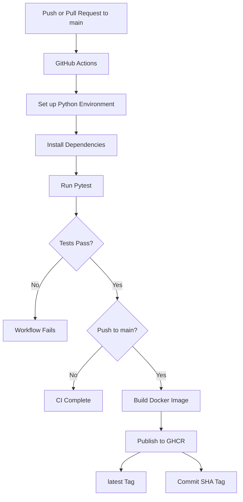

# Customer Churn Prediction API

An end-to-end machine learning project that predicts customer churn using a Scikit-learn classification pipeline, MLflow experiment tracking, FastAPI, and Docker.

The project demonstrates a practical machine learning workflow: data preprocessing, model training, experiment tracking, threshold tuning, model packaging, API development, testing, and containerization.

## Project Overview

Customer churn occurs when customers stop using a company's products or services. Identifying customers who are likely to leave can help businesses take proactive retention measures.

This project uses the IBM Telco Customer Churn dataset to predict whether a customer is likely to churn (`Yes`) or stay (`No`).

The trained model is exposed through a REST API built with FastAPI and packaged into a Docker container for deployment.

## Technologies Used

- **Python** – Core programming language
- **Pandas** – Data manipulation and preprocessing
- **Scikit-learn** – Machine learning pipeline and Logistic Regression
- **MLflow** – Experiment tracking and model management
- **FastAPI** – REST API development
- **Pydantic** – Request data validation
- **Pytest** – Automated API testing
- **Docker** – Application containerization
- **Uvicorn** – ASGI server

## Machine Learning Workflow

1. Load and inspect the Telco Customer Churn dataset.
2. Clean the data and handle missing values.
3. Separate numerical and categorical features.
4. Build a preprocessing pipeline using `StandardScaler` and `OneHotEncoder`.
5. Train a Logistic Regression classifier.
6. Evaluate model performance using a validation set.
7. Tune the classification threshold to balance precision and recall.
8. Log parameters, metrics, and the model using MLflow.
9. Package the trained model for API inference.

## Model Evaluation

The model uses a classification threshold of `0.3`, selected using validation-set F1-score evaluation.

| Metric | Test Result |
|---|---:|
| Accuracy | 75.37% |
| Churn Precision | 52.51% |
| Churn Recall | 75.40% |
| Churn F1-score | 61.91% |
| ROC-AUC | 84.30% |

The lower classification threshold prioritizes identifying more customers who are likely to churn, increasing recall at the cost of precision.

**Note:** These results are from the held-out test dataset. The threshold was selected using validation data.

## MLflow Experiment Tracking

MLflow is used to track model training experiments, including:

- Model parameters
- Evaluation metrics
- Classification threshold
- Trained model artifacts

The trained model is logged as `customer-churn-classifier` and packaged locally for API deployment.

## REST API

The FastAPI application provides the following endpoints:

| Method | Endpoint | Description |
|---|---|---|
| GET | `/` | API welcome endpoint |
| GET | `/health` | Health check |
| POST | `/predict` | Predict customer churn |

Interactive API documentation is available through Swagger UI at `/docs`.

### Example Prediction Request

```json
{
  "gender": "Female",
  "SeniorCitizen": 0,
  "Partner": "Yes",
  "Dependents": "No",
  "tenure": 12,
  "PhoneService": "Yes",
  "MultipleLines": "No",
  "InternetService": "DSL",
  "OnlineSecurity": "No",
  "OnlineBackup": "Yes",
  "DeviceProtection": "No",
  "TechSupport": "No",
  "StreamingTV": "No",
  "StreamingMovies": "No",
  "Contract": "Month-to-month",
  "PaperlessBilling": "Yes",
  "PaymentMethod": "Electronic check",
  "MonthlyCharges": 55.0,
  "TotalCharges": 660.0
}
```

The API returns the predicted churn class, churn probability, and prediction information.

## Running Locally

Clone the repository:

```bash
git clone https://github.com/LegitSJ/mlflow-customer-churn.git
cd mlflow-customer-churn
```

Create a virtual environment:

```bash
python -m venv .venv
```

Install dependencies:

```bash
pip install -r requirements.txt
```

Start the API:

```bash
uvicorn src.api:app --reload
```

Open the API documentation:

```text
http://127.0.0.1:8000/docs
```

## Running with Docker

Build the Docker image:

```bash
docker build -t customer-churn-api .
```

Run the container:

```bash
docker run --rm -p 8000:8000 customer-churn-api
```

Access the API:

```text
http://127.0.0.1:8000/docs
```


## CI/CD Pipeline

This project uses GitHub Actions to automate testing, Docker image building, and publishing to GitHub Container Registry (GHCR).

### Workflow

The CI/CD pipeline is triggered by pushes and pull requests targeting the `main` branch.

1. **Checkout:** GitHub Actions checks out the repository.
2. **Environment setup:** Sets up Python 3.14 and installs project dependencies.
3. **Automated testing:** Runs the Pytest test suite.
4. **Docker build:** If tests pass on a push to `main`, GitHub Actions builds the Docker image.
5. **Image publishing:** The image is published to GitHub Container Registry (GHCR).

Pull requests run the tests but do not publish Docker images.

### CI/CD Architecture



### Docker Image Registry

The published Docker image is available at:

`ghcr.io/legitsj/customer-churn-api`

Two tags are published:

- `latest` — Points to the most recently published image.
- Commit SHA — Identifies the image associated with a specific Git commit.

Using a commit-specific tag allows a particular build to be retrieved and tested independently of the moving `latest` tag.

### Pull and Run a Published Image

Pull the latest image:

```bash
docker pull ghcr.io/legitsj/customer-churn-api:latest
```

Alternatively, pull a specific commit version:

```bash
docker pull ghcr.io/legitsj/customer-churn-api:3be42b50c7fb4491023a44d3cba9759fde21c327
```

Run the API:

```bash
docker run --rm -p 8000:8000 ghcr.io/legitsj/customer-churn-api:3be42b50c7fb4491023a44d3cba9759fde21c327
```

Access the API documentation:

`http://127.0.0.1:8000/docs`

Check the API health endpoint:

`http://127.0.0.1:8000/health`


## Running Tests

Run the automated test suite:

```bash
python -m pytest -v
```

The tests cover API health checks, successful predictions, and invalid input validation.

## Project Structure

```text
mlflow-customer-churn/
├── data/
│   └── raw/
├── models/
│   └── customer-churn-classifier/
├── src/
│   ├── __init__.py
│   ├── train.py
│   ├── predict.py
│   └── api.py
├── tests/
│   └── test_api.py
├── Dockerfile
├── .dockerignore
├── requirements.txt
└── README.md
```

## Future Improvements

- Implement automated deployment to a cloud hosting environment.
- Implement model monitoring and data drift detection.
- Explore model retraining automation.
- Add model versioning and model registry workflows.
- Improve monitoring of model performance and prediction behavior.
- Explore alternative classification algorithms and compare performance.

---

**Project Focus:** Machine Learning · MLOps · Experiment Tracking · REST APIs · Model Deployment · Docker